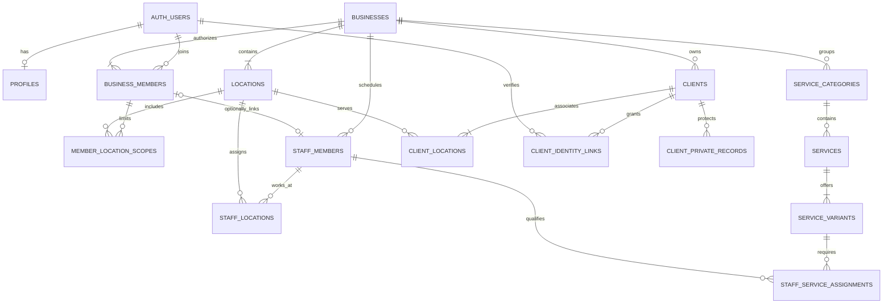
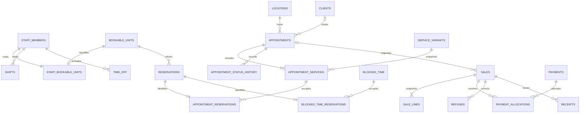
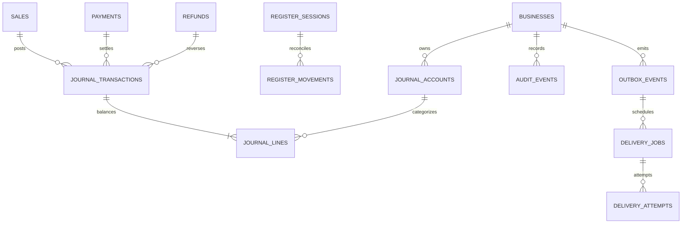

# Domain model and entity dictionary

**Status:** Proposed schema contract for implementation, 3 November 2026. No SQL tables are created in Phase 00.

## Ownership and key conventions

- UUID primary keys, server-created timestamps and versions for editable aggregates.
- Every business-owned row includes business_id, even when the parent implies it.
- Referenced tenant parents expose UNIQUE(business_id, id); matching composite foreign keys prevent cross-business links.
- A location relationship is checked through (business_id, location_id). A cross-location staff identity remains one staff record within its business.
- Auth identities and the controlled platform-operator registry are global exceptions; permission definitions are code-controlled global reference data.
- Clients belong to businesses and may associate with multiple locations through client_locations. Location-limited directory access requires an association or a permitted assigned-appointment projection.
- No financial/history cascade deletion. Archive referenced catalogue/person records; handle erasure through a separate retention/redaction workflow.
- Money columns are bigint minor units; API transport is decimal strings. See [money/time contract](MONEY_AND_TIME.md).
- Foreign keys, constraints, uniqueness, triggers and permissions must enforce these rules as migrations, not comments.

## Identity, configuration and CRM

Here AUTH_USERS represents the managed Supabase Auth identity, not a duplicate application password table. A business must retain at least one active owner, enforced by lifecycle commands rather than diagram cardinality alone.

## Scheduling and operations

Walk-ins have nullable client_id, not an invented shared anonymous client record. Appointment-to-sale uniqueness applies to an active posted checkout association, not every historical reversal. Resource reservations use typed bridge rows with enforced source relationships; an unchecked polymorphic source UUID is insufficient.

## Operational journal and events

System/job events need explicit actor_type and trusted machine identity; they do not fabricate an Auth user. Not every outbox event is a notification, and not every journal transaction originates from a sale.

## Initial entity dictionary

Fields below are required design concepts, not exhaustive DDL. Implement each group in its designated phase.

| Entity / group | Key fields and constraints | Phase |
|---|---|---|
| profiles | user_id → Auth; display/locale preferences only; no authority fields editable here | 02 |
| businesses | id, slug, name, status, currency, reporting zone; controlled status/ownership operations | 02, 04 |
| business_members | business_id, user_id, role, active state, scope mode; unique business/user | 02 |
| permission_definitions / role_permissions | controlled actions; no client writable permission grants | 02 |
| member_location_scopes | member + business/location composite refs; explicit all/selected semantics | 02, 04 |
| invitations | business, intended verified identity, granted role/scopes, token hash, expiry, consumed_at | 02 |
| platform_operators / support_grants | global controlled operator; business-scoped purpose/expiry for support; not a business role | 18 |
| locations | business, name, IANA zone, contact, active state; configurable locality | 04 |
| business_preferences / opening_hours / closed_periods | versioned local recurring rules and date exceptions; not interchangeable with staff shifts | 04 |
| staff_members | business, optional member_id, display name, active state; scheduling exists without login | 04 |
| staff_locations | tenant-safe staff/location eligibility | 04 |
| service_categories | business, translated labels, sort key, active state | 04 |
| services / service_variants | business/category, labels, fixed/from metadata, price_minor, currency, duration, buffer; archived state | 04 |
| service_locations / staff_service_assignments | tenant-safe offering/eligibility; required staff must serve selected location | 04 |
| tax_rate_versions | exact rate_ppm, mode applicability, effective dates; no default assumed statutory rate | 04, 08 |
| clients / client_locations | tenant profile/contact, archive state; location associations; duplicate warnings scoped to business | 05 |
| client_identity_links | business/client + verified user, active state, linking provenance; no implicit contact match | 05, 10 |
| client_private_records | client/location, author, visibility classification, protected content; separate read grants | 05 |
| client_tags / client_sources / consent_records | controlled labels; purpose/channel/verification/time; consent history append-only | 05 |
| attachment_metadata | business, permitted parent, Storage bucket/key, type/size/classification; no arbitrary URL trust | 05 |
| form_templates / form_versions / form_submissions | mutable drafts, immutable published schema/version, protected answers referencing exact version | 05 |
| import_jobs / import_rows | tenant, actor, preview/state/fingerprint/errors; commit and worker idempotency | 05, 11 |
| bookable_units / staff_bookable_units | one unit per staff across locations; room/equipment units location-bound; typed ownership | 04, 06 |
| shifts / breaks / time_off / blocked_time | local recurring/instant intervals as appropriate; all mutations share scheduling locks | 06 |
| appointments | business/location, nullable client, source, lifecycle status, version, quoted snapshots | 06 |
| appointment_services | appointment, service snapshot, eligible assigned staff, start/end/buffer; persisted order | 06 |
| reservations / source bridges | unit, busy_range, blocks_time, optional expires_at, constrained source; overlap exclusion | 06, 10 |
| appointment_status_history | previous/next, trusted actor, reason/time, immutable history | 06 |
| command_results | business/actor/operation/key/fingerprint/result; operation unique under retries | 02, 06 |
| sales / sale_lines | draft vs posted state, final line/tax snapshots, currency, version; posted facts immutable | 08 |
| payments / payment_allocations | method/source/status/reference, authorized settlement allocations, amount_minor strings at boundary | 08, 16 |
| refunds / refund_lines | original lines/payment refs, capped cumulative allocations, unique reversal/event key | 08 |
| journal_accounts / transactions / lines | per-business/currency balanced posting, source identity, immutable debit/credit entries | 08 |
| receipt_sequences / receipts | scoped number allocation, immutable issued facts, template/zone snapshots | 08 |
| register_sessions / movements | authorized location/register; opening float, movements, count/variance; no revenue conflation | 08 |
| report_views / export_jobs | private saved query definitions, allowed metrics/filters; protected results and expiry | 09, 11 |
| audit_events | business, server actor/object/event/time/correlation, allowlisted diff; client append/update denied | 02 onward |
| outbox_events | transaction-created event id/version/payload classification; no secrets/large attachments | 06 onward |
| notification_templates / delivery_jobs / attempts | language/version, due_at, event key, lease, attempt/provider status; consent/status recheck | 11 |

MVP service quantity is normally one; later fractional retail quantities follow the exact quantity contract. Services advertised as “from” require an agreed final price before posting; they do not permit an unbounded client total.

## Deferred extensions and dependencies

| Entities | Dependency and invariants | Phase |
|---|---|---|
| publication_settings / public_profiles / booking_requests / holds / waitlist_entries / offers | curated fields, verified contact/ownership, same reservation engine, explicit TTL/claim | 10 |
| products / variants / suppliers / purchase_orders / stocktakes / stock_movements | per-location immutable movements; checkout and receiving atomic | 12 |
| gift_cards / wallet_accounts / wallet_entries | hashed bearer code lookup, locked balances, liabilities and reversals | 13 |
| package_versions / sold_packages / benefit_entitlements / benefit_redemptions | snapshot purchased definitions; concurrent redemption caps | 13 |
| client_memberships / membership_periods | customer benefit plans; manual prepaid first, provider recurring only after integration | 13, 16 |
| compensation_versions / clock_events / timesheets / commission_entries / pay_runs | restricted pay data, effective-dated rules, one inclusion per earning, frozen approvals | 14 |
| segment_definitions / promotions / campaigns / recipients | constrained filter DSL, usage caps, consent recheck and suppression | 15 |
| loyalty_accounts / point_entries / tiers / rewards / referrals / reviews | verified events/visits, anti-abuse and append-only reversals | 15 |
| provider_connections / payment_intents / provider_events / settlements | backend secrets, signed mapped callbacks, idempotency and reconciliation | 16 |
| platform_plans / platform_subscriptions / entitlements / usage | business subscription separate from client memberships and salon payments | 02 pilot grants; 16 billing |
| conversations / participants / messages / attachment links | tenant/participant/record authorization; own delivery/idempotency lifecycle | 17 |
| accounting_sync_jobs / checkpoints / external_references | mapped provider accounts, no duplicate external posting | 17 |
| retention_requests / support_grants / recovery_events | scope, purpose, expiry, audit, restoration and approval | 18 |

## Index and integrity checklist

Plan indexes on business + location + time for appointment/report access; business + client/staff IDs for histories; membership by user/business/active state; normalized tenant-scoped contact/search; outbox/job due/state/lease; unique provider event and domain-effect identities.

Search, indices and projections must not disclose another business's rows. Record query plans and index verification in the implementation phase that creates each query. Partitioning, FX, complex capacity counters, offline writes and cross-business financial transfer are outside the initial model.

