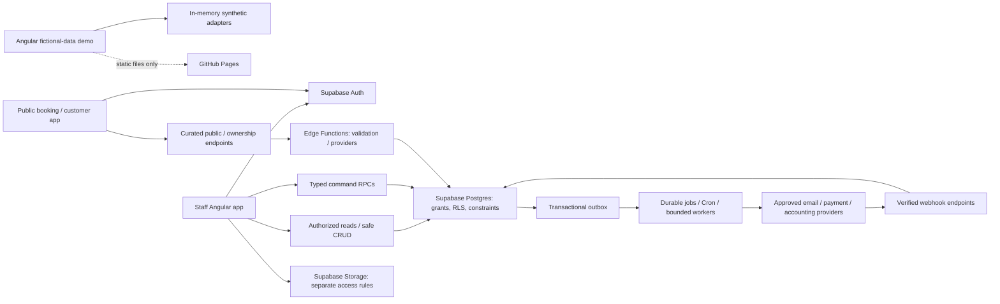

# Miznora architecture blueprint

**Phase:** 00 — architecture and scope  
**Date:** 3 November 2026  
**Status:** Design baseline; no application, database, policy or provider integration is implemented by this phase.

Current implemented subset: [Phase 02 identity/security contract](AUTH_AND_TENANT_SECURITY.md), [local/staging setup](../runbooks/PHASE02_LOCAL_SETUP.md), and [validation limits](../implementation/PHASE02_VALIDATION.md). The original Phase 00 design below remains the wider proposed product blueprint.

## Start here

This blueprint implements the selected [Phase 00 prompt](../implementation/00-architecture-and-scope.md) and [master requirements](../implementation/MASTER_PROMPT.md). It turns the [brand brief](../../Miznora_Brand_Overview.md) and [Fresha review](../Fresha_Feature_Analysis.md) into proposed Miznora decisions. It does not infer Fresha's internal architecture.

| Document | Implementation question answered |
|---|---|
| [ADR 001](ADR-001-application-boundaries.md) | Which code runs in Angular, Postgres and Edge Functions? |
| [ADR 002](ADR-002-tenancy-and-identity.md) | How do identities, businesses and permissions stay separate? |
| [ADR 003](ADR-003-hosting-and-auth-routing.md) | How do the demo and real app deploy and handle links? |
| [ADR 004](ADR-004-money-time-and-history.md) | What are the exact money, time and historical-data representations? |
| [ADR 005](ADR-005-transactions-reservations-and-jobs.md) | How are races, retries and background effects controlled? |
| [ADR 006](ADR-006-integrations-and-environment-lifecycle.md) | How are providers, environments and operational changes isolated? |
| [Domain model](DOMAIN_MODEL.md) | Initial ER diagram, ownership, entities, keys and implementation phases |
| [Permissions](PERMISSIONS.md) | Default roles, row/column scopes and authorization test matrix |
| [Routes and environments](ROUTES_AND_ENVIRONMENTS.md) | Route catalogue, callback flow, build targets and configuration |
| [Money and time](MONEY_AND_TIME.md) | Arithmetic, rounding, tax snapshots and business-day examples |
| [API contracts](API_CONTRACTS.md) | Commands, transport, errors, authorization and provider-neutral ports |
| [Workflows and invariants](WORKFLOWS_AND_INVARIANTS.md) | State machines, concurrency rules and failure outcomes |
| [Decisions register](DECISIONS_REGISTER.md) | Working assumptions, exact missing inputs and release gates |
| [MVP acceptance](MVP_ACCEPTANCE.md) | Scenarios and measurable phase/milestone completion evidence |
| [Feature coverage](../implementation/FEATURE_COVERAGE.md) | Every reference area and all 59 report names mapped to delivery scope |
| [Implementation log](../implementation/IMPLEMENTATION_LOG.md) | Phase state, inventory, executed checks and next dependencies |
| [Validation record](PHASE00_VALIDATION.md) | Documentation checks and preservation evidence |

## System shape

The diagram is a design, not deployed infrastructure. Public endpoints may use narrow database projections or trusted Edge functions according to [API contracts](API_CONTRACTS.md). Edge-issued mutations still use a single database command transaction.

## Repository inventory at phase start

- 35 existing files: 10 brand image/SVG assets, the brand brief, Fresha feature analysis and 23 implementation-prompt documents.
- Existing SVG masters: `logo.svg`, `logo-transparent.svg`, `app-icon.svg`. Keep raster originals and previews.
- No `AGENTS.md` found in the workspace or checked ancestor instruction paths.
- No `.git`, `frontend/`, `package.json`, `angular.json`, `supabase/`, migrations, tests or deployment workflow.
- Node reported v20.10.0. Git, npm and Python resolve on PATH; Supabase CLI and Docker did not.
- The npm version check failed with an EPERM path-access error. Phase 00 neither repaired nor certified the application toolchain.
- The brief's old asset filenames/lotus description differ from the current supplied SVG artwork. For implementation, reuse the actual SVG files; do not regenerate branding as part of scaffolding.

These inventory findings describe this local workspace only. No claim is made about unrelated installations or remote resources.

## Milestone boundaries

- **Design baseline:** Phase 00, these documents only.
- **Internal operational MVP:** Phases 01–09, manual payment recording, service operations and essential reports.
- **Customer-booking pilot:** Phases 10–11 added; required operational controls from Phase 18 and release checks from Phase 19 still apply.
- **Extended product:** Phases 12–18 as individually delivered; optional integrations remain deferred until selected.
- A demonstration or development milestone never implies production readiness.

## Initial product defaults

Use a single-location salon pilot as the working persona, while the data/access model supports multiple locations and two-business test fixtures from the beginning. Use English/Arabic, OMR, Asia/Muscat and configurable local calendar preferences. No payment processor, sender, hosting vendor, domain, production region or subscription price is selected.

The [decisions register](DECISIONS_REGISTER.md) separates these reversible implementation defaults from inputs that require a human/business decision. None blocks Phase 00 completion. Next authorized implementation phase, when requested: **01**.

