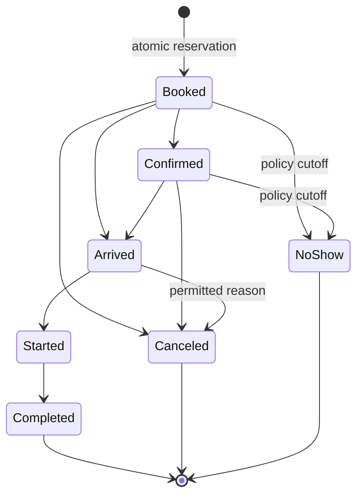
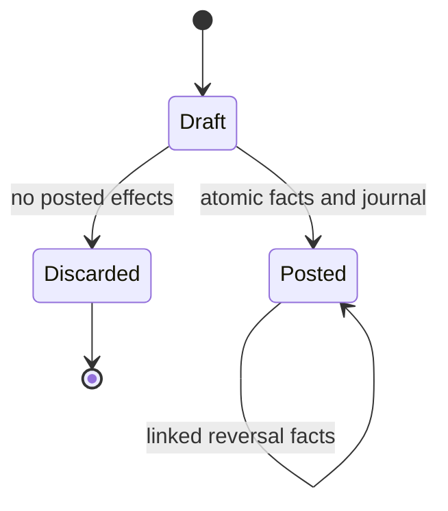
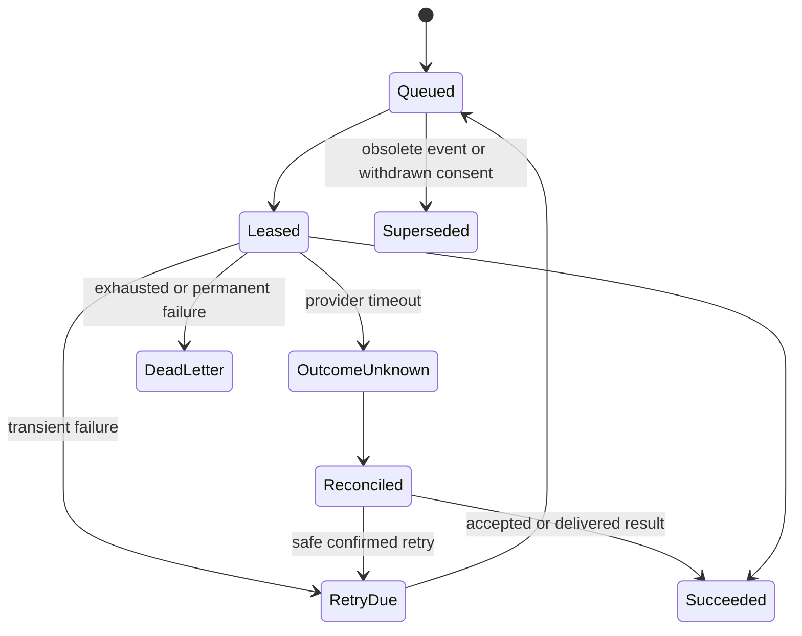

# Workflows, state machines and invariants

**Status:** Proposed behavior and implementation proof obligations, 3 November 2026.

## Appointment lifecycle

Default rules:

| Action | Conditions / effects |
|---|---|
| Create | validated service/staff/client/location; slot reservation and quote snapshot committed together |
| Confirm | allowed operational capability or verified configured flow; version/audit recorded |
| Arrive/start/complete | assigned professional or permitted receptionist/manager/owner; completed is operational, not paid |
| Reschedule | booked/confirmed only by default; transactional new reservation + old release, expected version and cutoff |
| Cancel | booked/confirmed/arrived with reason; release busy reservations; customer has narrower verified cutoff |
| No-show | booked/confirmed after configured eligibility time; trusted current time, reason/audit, explicit reservation release |
| Reopen terminal booking | not in MVP; create a new linked booking instead |
| Correct started/terminal facts | owner/manager controlled correction policy to be defined before enabling; no silent direct row update |

No refund or fee is automatically fabricated by a lifecycle change. A paid-booking cancellation can create an authorized refund request later, not an unsigned financial side effect. Completing a booking retains its historical reservation interval; shortening it requires a separate audited operation if later enabled.

Custom status labels must map to a constrained lifecycle class and cannot bypass reservations, audit or financial boundaries. MVP initially ships the default statuses.

## Sales, payments and refunds

Posted records remain posted historical facts. Read models derive unpaid/partial/paid and none/partial/full reversal from immutable allocations and reversals; they do not rewrite original sale lines.

- Only a validated draft can post once; one appointment's checkout association cannot be double-posted.
- Payment recording is separate from posting. Settlement allocations cannot exceed eligible money.
- Refunds reference original lines/payments, cap cumulative eligibility and append balanced reversal facts. Failure rolls back all related effects.
- Manual payment says “recorded manually”; it is not a provider capture.
- Tips, taxes and liabilities stay distinct from net service revenue.

Provider payment lifecycle later distinguishes pending, authorized, captured/settled, failed, cancelled, partially/fully refunded and disputed as actually supported. Unsupported transitions reject or reconcile. A late webhook cannot regress a settled payment into pending or over-credit a refund.

## Reservation and command sequence

1. Authenticate the specific actor mechanism and locate authorized context.
2. Acquire consistent business/config and sorted bookable-unit locks.
3. Validate current membership, scope, business state, version, service/staff eligibility, quote and availability policy.
4. Check idempotency key/fingerprint and domain uniqueness; identical concurrent attempts converge.
5. Insert/update all related records and enforce exclusion/foreign-key constraints.
6. Append status history, audit and outbox inside the same transaction.
7. Return the saved result. Any failure rolls the entire operation back.

All calendar-affecting writers use this protocol. Scheduled staff busy in one branch cannot book overlapping time in another. Units with capacity greater than one are modeled as separate physical units initially.

## Job and notification lifecycle

Job completion, provider acceptance and final message delivery are different facts. A crashed lease becomes recoverable. Before a send, recheck booking version/status, consent and current business policy. Operators cannot blindly requeue an unknown payment/notification outcome.

A reschedule supersedes old reminders; a waitlist claim rechecks actual slot availability and expiry inside the reservation command.

## Membership and business lifecycle

Invitation: pending → accepted / revoked / expired. Acceptance creates only the invited role/scope for the verified intended identity; duplicate acceptance returns the same result.

Business: active → suspended → active, or active/suspended → archived through an authorized lifecycle command. Retain at least one owner; owner transfer and member revocation are atomic.

Pilot entitlements are backend-controlled grants. Later platform subscription trial/active/past_due/grace/cancelled rules update grants through trusted billing events. They are not the same state as salon customer membership periods.

Suspension blocks normal new operational writes but does not discard incoming verified settlement/reconciliation events. Customer export/retention and urgent support corrections follow explicit scoped policies.

## Invariant register

| ID | Invariant | Prevention / future proof phase |
|---|---|---|
| I01 | No cross-business graph links | composite tenant FKs + RLS/direct API tests, 02 onward |
| I02 | No self-granted role/operator authority | controlled membership commands, noneditable authority tables, 02/18 |
| I03 | Last active owner remains | locked membership lifecycle commands, 02 |
| I04 | Every sensitive field has separate access semantics | separated tables/projections/Storage, 02/05/14 |
| I05 | No overlapping busy unit | shared reservation exclusion + all writer locks, 06 |
| I06 | Failed reschedule retains old slot | one transaction, 06 |
| I07 | A quote/sale keeps historical facts | copied versions/snapshots and immutable posting, 06/08 |
| I08 | One retry produces one effect | key + fingerprint + domain unique event, 02/06 onward |
| I09 | No partial financial posting | single DB command writes balanced journal and dependent effects, 08 onward |
| I10 | Refunds cannot exceed remaining original eligibility | locked cumulative checks and reversal identity, 08 |
| I11 | Wallet/stock/benefits cannot overspend | sorted account locks and transactional caps, 12/13 |
| I12 | Commission/payrun cannot count earning twice | frozen rules, earning identity and inclusion uniqueness, 14 |
| I13 | Public booking never reads CRM/busy-event identities | allowlisted projections/gateway and ownership checks, 10 |
| I14 | Old/opted-out marketing is suppressed | job recheck and purpose/channel consent, 11/15 |
| I15 | A redirect is not proof of provider payment | signed event mapping and reconciliation, 16 |
| I16 | Reports/exports preserve authorization and reconcile | scoped query contracts, metric dictionary and fixtures, 09 onward |
| I17 | Operator support is scoped and expires | independent registry, explicit grant and audit, 18 |
| I18 | Demo never connects to real auth/data/providers | separate build adapters and artifact validation, 01/19 |
| I19 | Revocation/suspension applies despite cached client state | authoritative transactional guards and scoped read policies, 02 onward |
| I20 | Restores retain security and ledger truth | staging restore drill across DB/files/config, 18/19 |

## Explicitly deferred behaviors

Recurring appointment rules, complex processing-time staff release, intentional overbooking, capacity counters, offline writes, multi-currency exchange and automatic payroll payouts are deferred pending separate acceptance rules. Their absence must not be hidden behind successful-looking UI.

