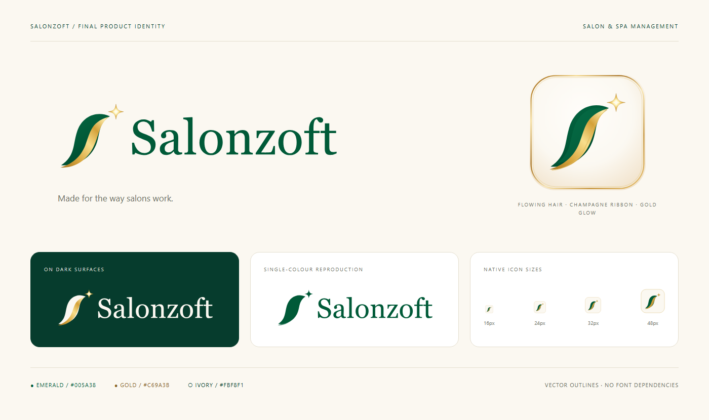
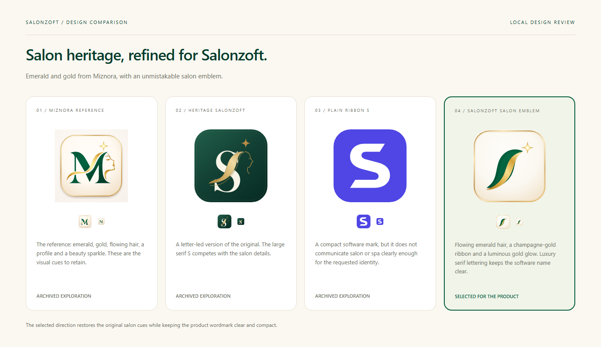

# Salonzoft — emerald and gold salon identity

The finalized brand identity combines Miznora's heritage green-and-gold luxury palette with a sculpted **Salonzoft** hair-and-glow emblem and high-contrast display serif wordmark. The mark features multi-layered emerald hair locks in an S-curve flow, a luminous champagne-gold ribbon with a calligraphic hair strand, and a four-point beauty glow star enclosed in a warm ivory tile with a double-beveled metallic gold rim.

## Palette and use

- Emerald `#005A38` (gradient `#056843` → `#005A38` → `#003B26`): emblem hair locks, wordmark and primary app actions.
- Champagne Gold `#C89A3B` (multi-stop metallic sheen `#A8741E` → `#F8DE8C` → `#FCEAA8` → `#B98528`): hair ribbon, calligraphic hair strand, beauty glow star and polished icon rim.
- Warm Ivory `#FBF8F1` (radial `#FFFDFA` → `#F1E2CA`): icon and presentation surface. Dark reversed artwork is designed for deep green surfaces (`#063C2D`).
- Default app header: horizontal logo (`logo-horizontal.svg`, 527 × 160 viewBox) without the small descriptor, rendered at 190–218 CSS pixels wide.
- Large placements: the stacked logo (`logo.svg` / `logo-transparent.svg`) includes the `SALON & SPA MANAGEMENT` descriptor flanked by decorative gold rules; use at 320 pixels wide or larger.
- Small icons: use `app-icon-simplified.svg`, which simplifies the rim detail and uses high-contrast flat fills so the hair silhouette, ribbon and glow star remain crisp down to 16 × 16 pixels.
- Keep clear space around the emblem, preserve its proportions and avoid adding effects inside the artwork.

## Assets

| Asset | Use |
|---|---|
| [Horizontal logo](../../logo-horizontal.svg) | App header (`527 × 160`) |
| [Reversed logo](../../logo-horizontal-dark.svg) | Dark backgrounds (`527 × 160`) |
| [Single-colour logo](../../logo-monochrome.svg) | One-colour reproduction (`527 × 160`) |
| [Stacked transparent logo](../../logo-transparent.svg) | Large brand placements (`800 × 640`) |
| [Stacked ivory logo](../../logo.svg) | Presentation use (`800 × 640`) |
| [Wordmark](../../wordmark.svg) | Name without emblem (`640 × 160`) |
| [Standalone emblem](../../brand-mark.svg) | Full-detail salon symbol (`256 × 256`) |
| [App icon](../../app-icon.svg) | Detailed icon with warm ivory tile and beveled metallic gold rim (`1024 × 1024`) |
| [Small icon](../../app-icon-simplified.svg) | Favicon and compact placements (`1024 × 1024`) |
| [App PNG](../../app-icon.png) | `1024 × 1024` |
| [Horizontal PNG](../../logo-horizontal.png) | `1054 × 320` transparent |
| [Stacked transparent PNG](../../logo-transparent.png) | `1600 × 1280` |
| [Small PNG exports](exports/) | 16, 24, 32, 48, 64, 128 and 256 pixels |

All lettering is outlined geometry. The SVGs display without installed fonts or embedded raster images. Rebuilding the wordmark on Windows uses Georgia (luxury serif) and Arial (spaced descriptor).

## Reproduction and checks

Run `./scripts/branding/generate-salonzoft.ps1`, then `node scripts/branding/render-salonzoft.mjs` with Playwright Chromium, then `npm run assets:sync`.

Checks for this revision: all nine SVGs parsed, gradient references resolved and frontend copies matched their masters. PNG dimensions and transparency were checked. Asset sync, lint and the demo build passed. Three targeted Playwright browser tests passed in 2.9 seconds, covering demo SVG delivery/navigation, workspace reset and mobile Arabic RTL. The stacked logo, identity board and desktop header were visually reviewed. No deployment or live backend validation was performed.

The preceding plain-S assets are preserved in [legacy-salonzoft-ribbon-s](legacy-salonzoft-ribbon-s/). The original reference remains in [legacy-miznora](legacy-miznora/); other intermediate designs remain archived.

## Finalized luxury serif & hair-and-glow emblem — 8 November 2026

Finalized the **Salonzoft** icon and logo design with the clean hair-and-glow emblem:
- **Sculpted Emerald & Gold Hair-and-Glow Emblem**: Multi-layered emerald hair locks (`#056843` → `#005A38` → `#003B26`), luminous champagne-gold ribbon (`#A8741E` → `#F8DE8C` → `#FCEAA8`) with a calligraphic hair strand, and a radial-lit four-point beauty glow star, centered cleanly without the facial profile space.
- **High-Contrast Luxury Serif Wordmark**: Outlined display serif `Salonzoft` lettering paired with spaced `SALON & SPA MANAGEMENT` descriptor and flanking gold rules on the stacked logos.
- **Warm Ivory Tile & Polished Metallic Rim**: Radial warm ivory tile (`#FFFDFA` → `#F1E2CA`) enclosed by a double-beveled metallic gold rim (`app-icon.svg`), plus a simplified small-icon master (`app-icon-simplified.svg`) for 16–256px favicons and compact badges.
- **Verification**: Archived the previous revision in `docs/branding/legacy-salonzoft-profile-v2/`. Regenerated all 9 self-contained SVG masters, 9 root PNGs, 7 small icon exports (`16px`–`256px`), and the identity/comparison/software review boards. Synchronized `frontend/public/brand/`, built all four targets (`demo`, `production`, `local`, `staging`), verified `check:demo`, lint, strict TypeScript checks, and passed all 12 Playwright E2E browser tests.
