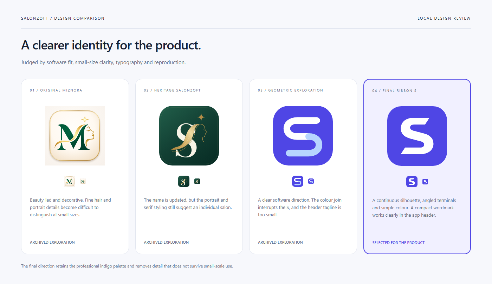
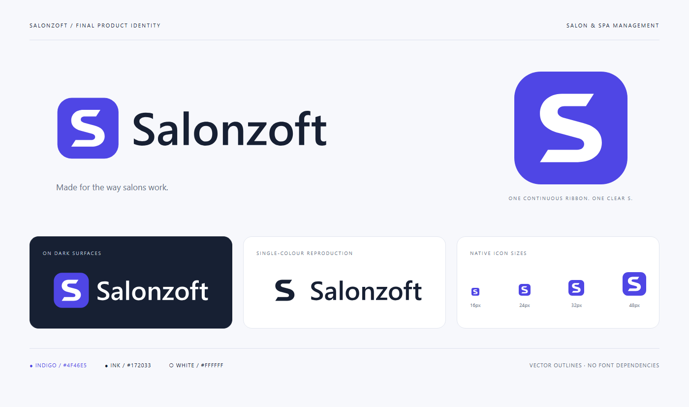

# Salonzoft final product identity

The final design uses a continuous ribbon S with angled terminals, an indigo tile and an outlined Segoe UI Semibold wordmark. The name is **Salonzoft**; the Arabic UI spelling is سالونزوفت.

## Design decision

| Direction | Assessment |
|---|---|
| Original Miznora | Decorative salon identity; portrait and hair details lose clarity at small sizes. |
| Heritage Salonzoft | Updates the initial but retains the visual language of an individual salon. |
| First geometric Salonzoft | Stronger software fit; the two-colour join interrupts the silhouette and the header tagline is too small. |
| Final ribbon S | Continuous single-colour silhouette, distinctive angled ends and a compact header wordmark. Selected as the product direction. |

These are visual design judgments from reviewing the local artwork and browser renders, not user-research results.

## Delivered assets

| Asset | Use |
|---|---|
| [Horizontal logo](../../logo-horizontal.svg) | Default app header; no tiny tagline |
| [Reversed horizontal logo](../../logo-horizontal-dark.svg) | Dark backgrounds |
| [Single-colour logo](../../logo-monochrome.svg) | One-colour reproduction on light backgrounds |
| [Transparent stacked logo](../../logo-transparent.svg) | Larger brand placements with descriptor |
| [Stacked logo with background](../../logo.svg) | Presentation use |
| [Wordmark](../../wordmark.svg) | Name without emblem |
| [Standalone symbol](../../brand-mark.svg) | Indigo S without tile |
| [App icon](../../app-icon.svg) | 1024-square vector with transparent corners |
| [Small app icon](../../app-icon-simplified.svg) | Same silhouette for favicon use |
| [App PNG](../../app-icon.png) | 1024 × 1024 raster |
| [Horizontal PNG](../../logo-horizontal.png) | 1082 × 320 transparent raster |
| [Transparent stacked PNG](../../logo-transparent.png) | 1600 × 1280 raster |
| [Small PNG exports](exports/) | 16, 24, 32, 48, 64, 128 and 256 pixels |

## Usage

- Primary colours: indigo `#4F46E5`, ink `#172033` and white `#FFFFFF`. Light presentation surface: `#F7F8FC`.
- Use the horizontal logo at 160 CSS pixels wide or larger. At narrower sizes use the app icon. Use the stacked logo at 320 pixels wide or larger so its descriptor remains readable.
- Keep at least one quarter of the tile width clear around the logo in placements outside the supplied canvas. Do not stretch, rotate or add shadows inside the artwork.
- Use the reversed wordmark on dark surfaces. Keep the full-colour icon on sufficiently contrasting surfaces; use the one-colour logo when colour is unavailable.
- SVG lettering is outlined; no installed fonts or external image resources are needed to display the assets. The Windows generator uses Segoe UI Semibold and Arial to rebuild outlines.

## Reproduction and verification

Run `./scripts/branding/generate-salonzoft.ps1`, then `node scripts/branding/render-salonzoft.mjs` with the existing Playwright Chromium installation, then `npm run assets:sync`. The renderer also recreates the comparison and final identity boards.

Nine SVGs were parsed and checked for embedded image/text dependencies; all frontend copies match their masters. Transparent PNG corner alpha is zero. The final icon was visually reviewed at 16, 24, 32 and 48 pixels, and the header was reviewed in the rendered app. Asset sync, lint and the demo build passed. Three targeted browser tests passed, covering demo navigation/SVG loading, workspace reset and mobile Arabic RTL. Backend workflows were not changed or revalidated in this design pass. No deployment was performed.

Previous artwork is preserved in [legacy-miznora](legacy-miznora/), [legacy-salonzoft-2026-11-08](legacy-salonzoft-2026-11-08/) and [legacy-salonzoft-geometric-v1](legacy-salonzoft-geometric-v1/).

